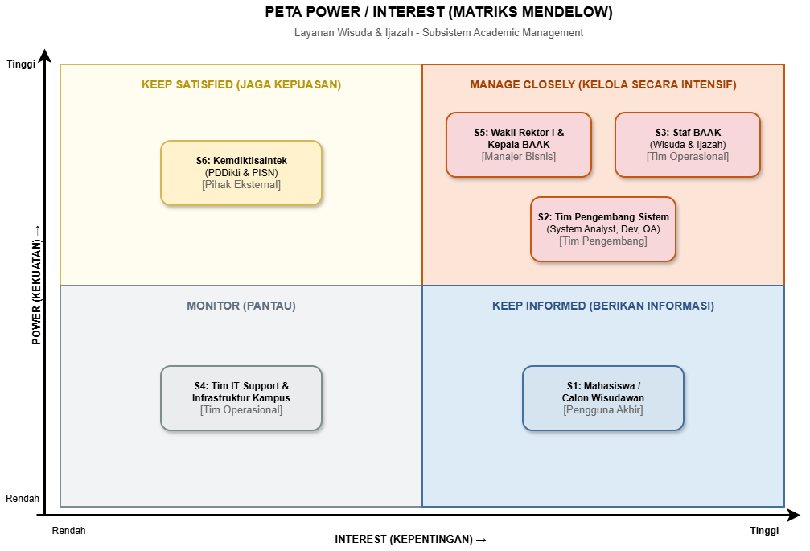

# A2. Stakeholder dan Peta Power/Interest

Penanggung jawab : Ihyanul hakim

| Kode | Stakeholder | Kelompok | Peran dalam Layanan | Kebutuhan Utama (Main Needs) | Ekspektasi Kualitas (Quality Attributes) | Prioritas |
| :---: | :--- | :--- | :--- | :--- | :--- | :---: |
| **S1** | **Mahasiswa Tingkat Akhir / Calon Wisudawan** | Pengguna Akhir | Pendaftar wisuda dan penerima ijazah | • Pendaftaran wisuda dan unggah berkas syarat secara *online*. • Pelacakan status verifikasi berkas secara *real-time* (diterima/revisi). • Informasi jadwal sesi wisuda, nomor kursi, dan jadwal antrean pengambilan ijazah. | **Usability & Availability:** Antarmuka intuitif (ramah *mobile*), notifikasi status otomatis, dan sistem tidak *down* saat pendaftaran dibuka. | **Tinggi** |
| **S2** | **Tim Pengembang Sistem (System Analyst, Developer, QA)** | Tim Pengembang | Perancang, pembuat, dan penguji modul | • Spesifikasi aturan bisnis (*business rules*) syarat berkas, penjadwalan, dan format ijazah yang jelas. • Dokumentasi skema *database* SIAKAD untuk integrasi status kelulusan/yudisium dan keuangan. | **Modularity & Testability:** Arsitektur kode modular, dokumentasi API jelas, dan mudah diuji sebelum rilis. | **Tinggi** |
| **S3** | **Staf Biro Administrasi Akademik (BAAK) – Unit Wisuda & Ijazah** | Tim Operasional | Pengelola operasional harian layanan wisuda & ijazah | • Fitur verifikasi berkas mahasiswa dan pemberian catatan revisi. • Pengaturan kuota/sesi jadwal wisuda dan daftar hadir. • Pencetakan draf/blangko ijazah serta pencatatan status serah terima (pengambilan) ijazah di loket. | **Reliability & Operability:** Proses verifikasi cepat, ekspor data cetak ijazah akurat (bebas *typo*), serta *audit trail* pengambilan ijazah yang jelas. | **Sangat Tinggi** |
| **S4** | **Tim IT Support & Infrastruktur Kampus** | Tim Operasional | Pemelihara server, jaringan, dan *helpdesk* teknis | • Pemantauan kapasitas server (*server load*) dan penyimpanan file berkas wisuda. • Sistem *backup* rutin dan log *error* untuk penanganan kendala teknis. | **Maintainability & Scalability:** Sistem mudah dipantau (*monitoring*) dan kapasitas penyimpanan dokumen teroptimasi. | **Rendah** |
| **S5** | **Wakil Rektor Bidang Akademik (WR I) & Kepala BAAK** | Manajer Bisnis | Pemilik proses bisnis (*Process Owner*) & penentu kebijakan akademik | • *Dashboard* eksekutif untuk memantau jumlah pendaftar, keterisian kuota jadwal wisuda, dan progres verifikasi berkas. • Otorisasi penetapan jadwal wisuda dan pengesahan daftar lulusan penerima ijazah. | **Data Integrity & Security:** Data lulusan 100% valid dan konsisten, keamanan akses berbasis peran (*Role-Based Access Control*), serta patuh kalender akademik. | **Sangat Tinggi** |
| **S6** | **Kemdiktisaintek (PDDikti & Sistem PISN)** | Pihak Eksternal | Regulator nasional penomoran & keabsahan ijazah | • Sinkronisasi data kelulusan mahasiswa dengan PDDikti. • Pemenuhan syarat pengajuan **PIN (Penomoran Ijazah Nasional)** agar ijazah sah dan terdaftar secara nasional. | **Interoperability & Compliance:** Format data ekspor/API sesuai standar skema PDDikti/PISN dan validasi syarat SKS/masa studi terpenuhi. | **Tinggi** |

##

<!-- Penanggung jawab: [nama] -->
<!-- Yang diminta: Stakeholder register minimal 6 stakeholder dari lima kelompok, ditambah peta power/interest (gambar dari folder diagram/). -->
<!-- Hapus komentar ini setelah bagian selesai. -->

